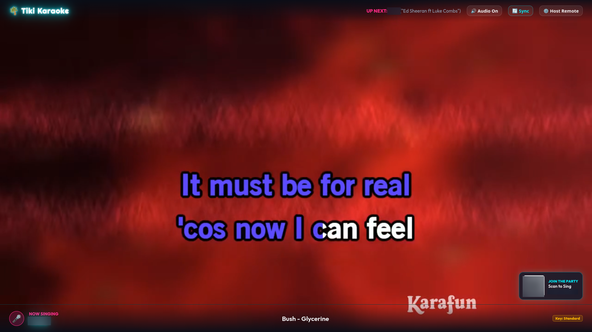
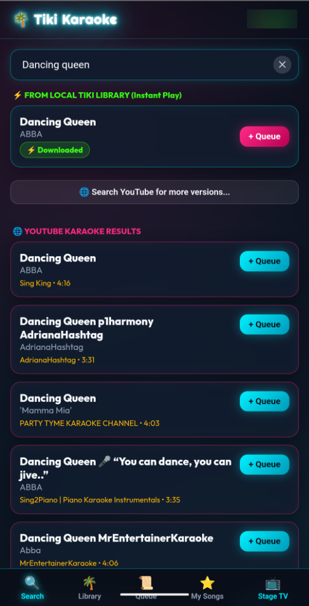
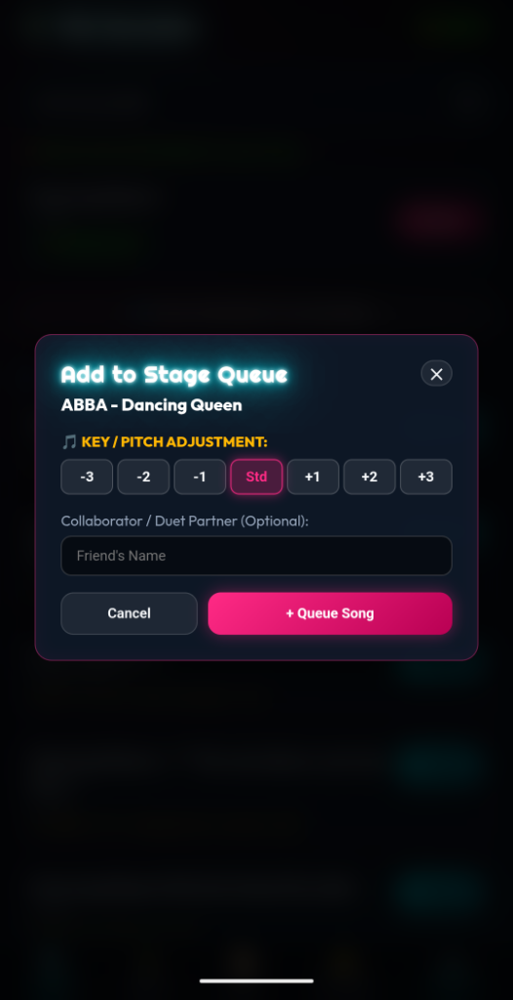
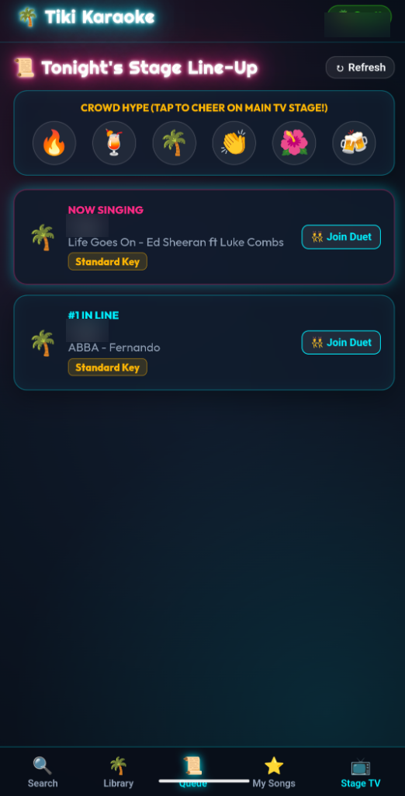
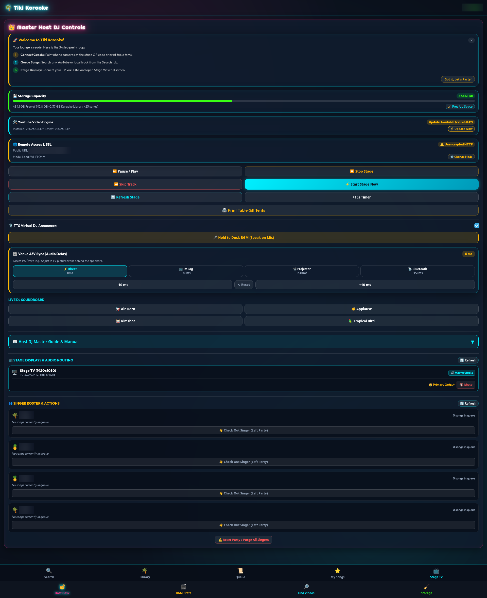
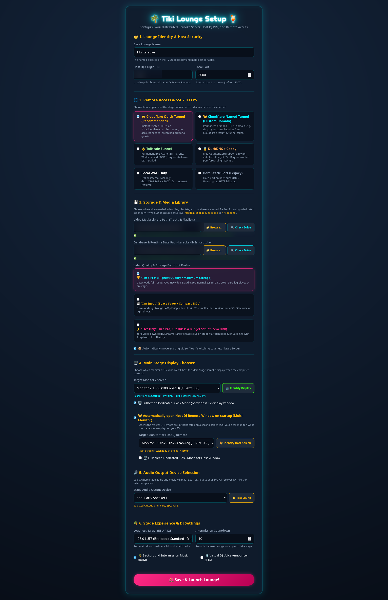
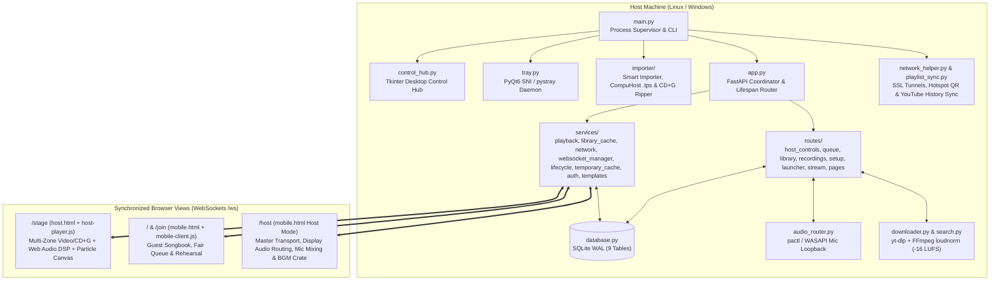

<p align="center">
  <a href="https://ko-fi.com/todd0042">
    
  </a>
</p>

---

# 🌴 Tiki Karaoke Lounge & Neon Bar

[](https://github.com/Todd0042/tiki-karaoke/releases)
[](LICENSE)
[%20%7C%20Windows-orange.svg)](https://github.com/Todd0042/tiki-karaoke/releases)
[]()
[]()
[](https://ko-fi.com/todd0042)

> **Turn any TV, computer, and your guests' smartphones into a neon tropical karaoke lounge in 60 seconds — with zero apps for guests to install, fair round-robin queueing, real-time vocal & track DSP, and 100% local data ownership.**

<p align="center">
  
</p>

---

## 📖 Table of Contents

* **Part 1 — Consumer Overview & Quick Start**
  * [🍹 What Is Tiki Karaoke Lounge?](#-what-is-tiki-karaoke-lounge)
  * [🎉 How a Party Works in 3 Steps](#-how-a-party-works-in-3-steps)
  * [🌺 Companion Studio: Tiki Rehearsal Lounge](#-companion-studio-tiki-rehearsal-lounge)
  * [📸 Visual Tour](#-visual-tour)
  * [✨ Party Highlights at a Glance](#-party-highlights-at-a-glance)
  * [🚀 Quick Download & Installation (Linux & Windows)](#-quick-download--installation)
* **Part 2 — Consolidated Technical Documentation & Architecture Reference**
  * [1. System Architecture & Real-Time WebSocket Engine ([app.py](app.py), [main.py](main.py))](#1-system-architecture--real-time-websocket-engine)
  * [2. Audio Routing & 3-Mode Microphone Monitoring ([audio_router.py](audio_router.py))](#2-audio-routing--3-mode-microphone-monitoring)
  * [3. Real-Time Track Audio DSP, EBU R128 Normalization & Venue A/V Sync ([services/lufs.py](services/lufs.py), [static/js/audio-dsp.js](static/js/audio-dsp.js))](#3-real-time-track-audio-dsp-ebu-r128-normalization--venue-av-sync)
  * [4. Native CD+G Subcode Graphics Engine & Optical Disc Ripper ([importer/cdg_ripper.py](importer/cdg_ripper.py))](#4-native-cdg-subcode-graphics-engine--optical-disc-ripper)
  * [5. Fair Round-Robin Queue & Singer Experience Mechanics ([database.py](database.py))](#5-fair-round-robin-queue--singer-experience-mechanics)
  * [6. 4-Stage Intermission Vibe Engine & Audio-Reactive Stage Visuals ([database.py](database.py))](#6-4-stage-intermission-vibe-engine--audio-reactive-stage-visuals)
  * [7. Storage Footprint Profiles, Smart Media Importer & CompuHost Migration ([importer/scanner.py](importer/scanner.py), [importer/tps_parser.py](importer/tps_parser.py))](#7-storage-footprint-profiles-smart-media-importer--compuhost-migration)
  * [8. Connectivity Modes, SSL Tunnels & Offline Hotspot QR ([network_helper.py](network_helper.py))](#8-connectivity-modes-ssl-tunnels--offline-hotspot-qr)
  * [9. CLI Arguments, Configuration Schema (`config.json`) & Environment Variables ([config.py](config.py))](#9-cli-arguments-configuration-schema-configjson--environment-variables)
  * [10. Repository Structure & Automated Verification Suite ([tests/](tests/))](#10-repository-structure--automated-verification-suite)
  * [11. Ethics, Clean-Room Audio Provenance & Licensing ([LICENSE](LICENSE))](#11-ethics-clean-room-audio-provenance--licensing)

---

# Part 1 — Consumer Overview & Quick Start

## 🍹 What Is Tiki Karaoke Lounge?

**Tiki Karaoke Lounge** is a self-hosted, turnkey karaoke party server and live stage player designed for living rooms, house parties, backyard tiki bars, and audio enthusiasts. 

Instead of passing around a keyboard or fighting with dated desktop interfaces, Tiki Karaoke splits the party into three synchronized views:
1. **📺 The TV Stage (`/stage`)**: Connects to your TV or projector via HDMI. Displays scrolling lyrics, retro neon tiki visuals, intermission music videos, countdown timers, and a scannable QR code.
2. **📱 The Guest Smartphone Songbook (`/join`)**: Guests point their phone camera at the TV QR code—**no app download or account required**. They pick a nickname and tropical avatar, search songs, adjust their vocal key, join duets, and tap emojis that burst onto the TV screen in real time.
3. **👑 The Host DJ Desk & Desktop Control Hub (`/host`)**: Control the entire show from your PC or unlock the Master DJ Remote right on your own phone using a 4-digit PIN.

---

## 🎉 How a Party Works in 3 Steps

1. **Launch & Connect Your TV**: Start Tiki Karaoke on your Linux or Windows PC. Use the Desktop Control Hub (or First-Run Setup Wizard) to pick which screen is your TV Stage and which audio output/microphone you're using.
2. **Guests Scan to Join**: Friends scan the QR code on the TV screen (or on printed 3D Table Tents) to open the mobile songbook in Safari, Chrome, or Firefox.
3. **Sing, Cheer & Keep Souvenirs**: The Fair Round-Robin Queue automatically rotates turns so everyone gets stage time. Between songs, the stage plays crowd sing-alongs or music videos automatically, and singers can even download a souvenir MP3 recording and retro 45 RPM vinyl album jacket of their performance!

---

## 🌺 Companion Studio: Tiki Rehearsal Lounge (v1.0.8)

Want to warm up your voice or dial in your optimal key before taking the stage?

**[Tiki Rehearsal Lounge](https://github.com/Todd0042/tiki-rehearsal-lounge)** is the official standalone & companion practice studio for Tiki Karaoke. When installed on the same system, the **Desktop Control Hub** automatically detects it and adds a **"🌺 Launch Tiki Rehearsal Lounge"** button.

* **🎯 2-Step Vocal Calibration**: Measure your natural speaking anchor note and siren pitch sweep ($Ooo \rightarrow Aaa$) with high-resolution autocorrelation to detect your vocal category (Bass to Soprano) and comfort sweet spot.
* **✨ Smart Key Recommendation**: Compares your vocal profile against any song in your library and suggests the optimal transposition between **-3 and +3 semitones** so you never strain on high notes.
* **🎹 6-Voice Harmonic Tone Generator**: Zero-latency procedural reference tones (Grand Piano, Rhodes, Cello, Strings, Synth Flute, Brass) for warming up.
* **📊 Post-Take Vocal Report Cards & Real-to-Life Auditory Appeal**: Multi-core parallel DSP records your rehearsal take, suppresses ambient backing track speaker bleed, and evaluates relative scale degrees, melodic phrase contour ($\Delta f[n]$), and genre-aware consonance.
* **🧠 Expandable Offline AI Studio & Progression Tracker**: Optional right-hand **Maestro Tiki AI Studio** side panel powered by a bundled standalone `llama.cpp` engine running local open-weights models on CPU/GPU, while keeping pure Python DSP 100% independent. Tracks take-over-take growth in an isolated rolling database (`rehearsal_history.db`) with zero telemetry or cloud dependencies.
* **🔗 Get Rehearsal Lounge**: Available on [GitHub](https://github.com/Todd0042/tiki-rehearsal-lounge) and downloadable on [itch.io](https://todd0042.itch.io/tiki-karaoke-lounge) for **Windows** (`rehearsal-windows`, `rehearsal-windows-portable`) and **Linux** (`rehearsal-linux`)!

---

## 📸 Visual Tour

### 📺 Main TV Stage Display
Borderless fullscreen stage with synchronized lyrics, audio-reactive neon Tiki totems, floating tropical embers, "Now Singing / Up Next" HUD, and live audience emoji bursts:

<p align="center">
  
</p>

### 📱 Guest Smartphone Songbook (Zero App Install)
Guests browse the instant local library or search online, transpose key/pitch ($\pm 3$ semitones), add duet partners or song dedications, and cheer from their seats:

| 🔍 Instant Search & Sing-Along Toggle | 🎵 Key/Pitch Shift, Duets & Dedications | 📜 Fair Queue & Live Emoji Hype |
| :---: | :---: | :---: |
|  |  |  |
| *Browse local tracks or search online* | *Transpose vocal key & invite duet partners* | *Track your turn & cheer on the main TV* |

### 👑 Host DJ Master Command Desk & Initial Setup Wizard
Full live transport, 3-mode microphone mixing with dual-singer VU meters, Venue A/V Sync calibration, BGM Video Crate, and multi-monitor hardware setup:

| 👑 Host DJ Command Desk | ⚙️ Hardware & Audio Setup Wizard |
| :---: | :---: |
|  |  |

---

## ✨ Party Highlights at a Glance

* **⚖️ Fair Round-Robin Queue**: Automatically balances turns across all singers so newcomers never get buried behind someone who queued 10 songs in a row. Guests can also tap **"Pause My Turn (Step Away)"** while grabbing a drink without losing their spot.
* **👥 Sing-Along Mode & "Spin the Tiki Wheel"**: A 1-tap toggle lets guests browse and request tracks *with* lead guide vocals included so the whole room can sing together—or tap **🎰 Spin the Tiki Wheel** to let the lounge pick a random crowd-pleaser from the local catalog.
* **📺 Multi-Room Stage Displays & Thin-Client Remote Gigging**: Because the Stage view is powered by synchronized WebSockets and HTTP media streaming, you can open `/stage` across multiple TVs in different rooms simultaneously (selecting which screen acts as the Master audio output from the Host Desk), or keep your server PC at home and run an entire gig at a remote venue using only a laptop or smartphone with an HDMI adapter.
* **🎵 Real-Time Key/Pitch Shifting & Vocal DSP**: Shift any song from `-3` to `+3` semitones in real time without changing tempo, plus optional warm vocal plate reverb, dual-singer VU meters, and automatic between-song BGM speech ducking.
* **💿 Classic Karaoke CD (`CD+G`) & Modern Video Support**: Plays `.mp4`, `.mkv`, `.webm`, and classic `.mp3` + `.cdg` (or `.zip`) discs with 4 modernized neon color themes—plus a built-in optical CD+G disc ripper.
* **🌴 Non-Stop Intermission Autopilot**: Never suffer awkward dead air between singers. Automatically plays crowd sing-alongs or music videos matched to the era and genre of tonight's singers, with a 90-minute cooldown so it never spoils a song someone just sang.
* **🎙️ Souvenir Live Recordings & Retro Vinyl Art**: Optionally records live performances (vocals + backing music summed to MP3) and generates a downloadable **1080×1080 Retro 45 RPM Vinyl Record Jacket** for the singer's camera roll.
* **🖨️ Printable 3D Table Tents**: Generate a single-page foldable table tent sheet (`/host/print-tents`) with your Wi-Fi QR code and Songbook QR code for your party tables.
* **🔒 100% Private, Ad-Free & Local-First**: Zero telemetry, zero cloud accounts required, and zero advertisements.

---

## 🚀 Quick Download & Installation

### 🐧 Universal Linux AppImage (Ubuntu, Debian, Fedora, Mint, Arch, SteamOS)
Download `TikiKaraoke-Pro-v1.1.4-x86_64.AppImage` directly from [GitHub Releases](https://github.com/Todd0042/tiki-karaoke/releases):
```bash
chmod +x TikiKaraoke-Pro-v1.1.4-x86_64.AppImage
./TikiKaraoke-Pro-v1.1.4-x86_64.AppImage
```

### 🪟 Windows 10 & 11 (64-Bit)
Download the standalone Windows release on **[itch.io (Tiki Karaoke Lounge)](https://todd0042.itch.io/tiki-karaoke-lounge)**:
* **Standalone Installer**: Run `TikiKaraokeSetup-Pro-1.1.4.exe` to install to your Desktop and Start Menu.
* **Portable ZIP**: Extract `TikiKaraoke-Pro-Windows-v1.1.4-Portable.zip` anywhere and launch `TikiKaraoke.exe` (no administrative privileges required; FFmpeg and WASAPI mic router come pre-bundled).

### 🛠️ Run from Source (Cross-Platform)
Tiki Karaoke is fully open-source and can be run directly from source on any operating system:
```bash
# 1. Clone the repository
git clone https://github.com/Todd0042/tiki-karaoke.git
cd tiki-karaoke

# 2. Linux automated installation
./install.sh && ./start.sh

# Or Windows manual launch:
pip install -r requirements.txt
start.bat
```

---
---

# Part 2 — Consolidated Technical Documentation & Architecture Reference

> *The sections below provide an exhaustive, code-verified engineering reference of every module, DSP pipeline, database algorithm, API/WebSocket contract, and configuration parameter in Tiki Karaoke Lounge `v1.1.4`.*

---

## 1. System Architecture & Real-Time WebSocket Engine

Tiki Karaoke is built on a modular asynchronous Python backend ([app.py](app.py), [main.py](main.py)) powered by **FastAPI**, **Uvicorn**, and **SQLite (`aiosqlite` in WAL mode)**, paired with a zero-framework vanilla JavaScript/HTML5 Canvas/Web Audio API frontend. The application server is cleanly partitioned into high-cohesion `routes/` and standalone background `services/`.



### Desktop Control Hub & System Tray Daemon
* **Native Desktop Control Hub ([control_hub.py](control_hub.py))**:
  * Launches a dark-themed Tkinter command window displaying real-time server health, active tunnel URL, side-by-side scannable **Guest Join QR** and **Host DJ Remote QR** codes, a live *"Now Singing / Queue Count"* ticker, and a collapsible real-time stdout/stderr log viewer.
  * Provides 1-click action buttons to launch the **Host DJ Desk**, **TV Stage Display**, **Smart Media Importer**, **CD+G Optical Disc Ripper**, and **Setup Wizard**.
  * Intercepts `WM_DELETE_WINDOW` to minimize cleanly to the system tray while keeping the party running in the background.
* **Cross-Platform System Tray ([tray.py](tray.py))**:
  * On Linux Wayland/KDE/GNOME, spawns an isolated **PyQt6 / PySide6 `QSystemTrayIcon`** subprocess (`StatusNotifierItem` DBus protocol) so the tray icon and context menu render natively without blocking the main asyncio/Tkinter thread.
  * Automatically falls back to `pystray` on X11 and Windows.
* **Single-Instance & Multi-Monitor Window Placement ([main.py](main.py), [config.py](config.py))**:
  * Probes `http://127.0.0.1:8000/api/state` on startup; if an instance is already running, focuses or opens the requested view instead of spawning duplicate servers.
  * Detects physical monitor geometry via `xrandr`, GDK, `/sys/class/drm` (Linux), or `Win32 GetMonitorInfo` / PowerShell (Windows), and launches the Stage and optional Host Desk windows directly onto their assigned displays with zero-click autoplay enabled (`media.autoplay.default=0` in Firefox profile or `--autoplay-policy=no-user-gesture-required` in Chromium).

### Multi-Zone Stage Display Topologies & Per-Screen Audio Routing
Because `/stage` operates entirely over stateless HTTP byte-range streaming ([routes/stream.py](routes/stream.py)) and real-time WebSocket state envelopes ([services/websocket_manager.py](services/websocket_manager.py)), the display architecture naturally supports flexible multi-screen and remote-venue deployments without video splitters or long HDMI runs:
* **Simultaneous Multi-Room Stage Displays (`register_stage_display`)**: Any number of TVs, projectors, patio monitors, or tablets can open `/stage` concurrently. Every connected display registers its unique `display_id`, device label, IP address, and audio mute state with [`ConnectionManager`](services/websocket_manager.py), staying locked to the exact same playhead, countdown timers, CD+G packet frames, and crowd reaction bursts.
* **Remote Per-Display Audio & Master Screen Assignment (`GET /api/host/displays` & `POST /api/host/display/{display_id}/audio`)**: From the **Host DJ Desk**, the host can view all active stage displays in real time, remotely `mute` or `unmute` individual screens, or trigger `set_master` to designate a single screen as the **Master Audio Output** while automatically muting all secondary displays to prevent multi-room acoustic echo.
* **Zero-Footprint Remote Venue Deployment (Home-Server to Thin-Client Gigging)**: When paired with an outbound SSL tunnel (`cloudflare_quick`, `cloudflare_named`, or `tailscale`), the host's primary PC and multi-terabyte karaoke library can remain stationary at home while an entire event is hosted at a remote venue using only a lightweight laptop or smartphone connected to the venue TV/PA via HDMI.

### Real-Time WebSocket Event Catalog (`/ws`)
[`ConnectionManager`](services/websocket_manager.py) broadcasts JSON state envelopes to all connected Stage, Host, and Mobile clients:

| Event `type` | Direction | Payload & Behavior |
| :--- | :--- | :--- |
| `state_sync` | Server $\rightarrow$ All | Full playback state (`status`: `idle`, `intermission`, `playing`, `paused`, `filler_playing`), `current_song`, `up_next`, `countdown`, `pitch_semitones`, `vocal_cut_enabled`, `venue_av_sync_ms`, `stage_mic_state`, `cdg_theme`, and `playhead_time` with server timestamp for RTT drift calculation. |
| `queue_updated` | Server $\rightarrow$ All | Triggered whenever a song is queued, reordered, skipped, completed, or when a singer toggles `on_break` / checks out. |
| `pending_downloads_updated` | Server $\rightarrow$ All | Live download percentage (`0–100%`), status (`downloading`, `normalizing`, `retrying`, `failed`), and error recovery metadata for staged tracks. |
| `playhead_report` / `playhead_sync` | Stage $\rightarrow$ Server $\rightarrow$ All | Stage reports playhead every 2s; server relays to handheld `/stage?mute=1` lyric monitors to keep lyrics locked within `<150ms`. |
| `register_display` / `displays_updated` / `set_display_audio` | Stage $\leftrightarrow$ Server $\leftrightarrow$ Host | Registers each connected `/stage` screen (`display_id`, `name`, `is_muted`, `ip`) and allows the Host Desk to remotely mute/unmute screens or switch the active Master Audio display. |
| `reaction` | Mobile $\rightarrow$ Server $\rightarrow$ Stage | Real-time crowd emoji (`🔥`, `🍹`, `🌴`, `👏`, `🌺`, `🍻`) rate-limited to 5/sec per socket; triggers floating animations, particle bursts, and the `x4+` Crowd Hype Combo Multiplier on stage. |
| `singer_joined` | Server $\rightarrow$ Stage | Displays a floating neon welcome pill on the TV stage when a new guest registers. |
| `singer_on_deck` | Server $\rightarrow$ Mobile | Fired when `duration - playhead <= 30s` on the current song; vibrates the next singer's phone (`navigator.vibrate`) and slides down the *"YOU'RE UP IN ~30 SECONDS!"* banner. |
| `recording_ready` | Server $\rightarrow$ Mobile | Notifies the singer who just finished performing that their souvenir MP3 recording and vinyl album jacket are ready in their *My Songs* tab. |
| `mic_vu_levels` | Stage $\rightarrow$ Server $\rightarrow$ Host | Streams real-time Left (Singer 1) and Right (Singer 2) microphone peak levels (`0–100%`) at ~5Hz to the Host DJ Desk. |
| `soundboard` / `tts_announce` / `stage_marquee` | Host $\rightarrow$ Server $\rightarrow$ Stage | Triggers synthesized DJ sound effects (`airhorn`, `applause`, `rimshot`, `bird`), Web Speech API / Google TTS singer introductions, or timed scrolling announcements across the TV screen. |
| `show_wrapped` | Host $\rightarrow$ Server $\rightarrow$ Stage | Broadcasts session highlight statistics (`get_party_wrapped_stats()`) and displays the retro synthwave Party Wrapped podium overlay with ambient lounge BGM when the host clicks **Stop Stage**. |
| `renormalize_progress` | Server $\rightarrow$ Host | Real-time batch Loudness Calibration progress (`current`, `total`, `track_id`, `title`, `lufs`) during background library audio recalibration. |
| `renormalize_complete` | Server $\rightarrow$ Host | Signals completion of the Library Loudness Calibration run with total recalibrated tracks count. |

---

## 2. Audio Routing & 3-Mode Microphone Monitoring

Live vocal monitoring is the hardest problem in PC-based karaoke because browser audio buffers and HDMI/Bluetooth outputs introduce noticeable echo. Tiki Karaoke solves this with a selectable **3-Mode Microphone Architecture** ([audio_router.py](audio_router.py), [packaging/windows/tiki_karaoke.spec](packaging/windows/tiki_karaoke.spec), and [static/js/audio-dsp.js](static/js/audio-dsp.js)):

| Mode | Latency | Architecture & Best Use Case |
| :--- | :---: | :--- |
| **1. Hardware Direct** (`hardware_direct`) | **~0 ms** | **External Mixer / Audio Interface Bypass**: Software mic routing is completely disabled so your physical PA mixer or USB audio interface's hardware *Direct Monitor* knob handles vocals with zero digital delay. |
| **2. Native OS Loopback** (`native` — *Default*) | **~1–15 ms** | **Kernel / Audio-Server Direct Routing**: Routes the selected microphone directly to the stage speaker sink at the OS level, bypassing browser audio buffers entirely.<br/>• **Linux**: [`NativeAudioRouter`](audio_router.py) manages PipeWire/PulseAudio `module-loopback` (`latency_msec=1`) and source/sink volume via `pactl`.<br/>• **Windows**: [`WasapiAudioRouter`](audio_router.py) spawns the bundled `tiki-mic-router.exe` helper, a custom **WASAPI shared-mode event-driven** audio router (`AUDCLNT_STREAMFLAGS_EVENTCALLBACK` + `AUDCLNT_STREAMFLAGS_AUTOCONVERTPCM`) with lock-free ring buffering, Q16.16 linear resampler, automatic mono-to-stereo duplication, live JSON-lines stdin volume/mute control, and a background watchdog thread that auto-restarts if a USB mic is unplugged/replugged. |
| **3. Browser WebRTC Vocal Bus** (`browser`) | **80–300 ms** | **Full Web Audio Vocal DSP & Bluetooth/HDMI-TV Fallback**: Captures the microphone with raw studio constraints (`echoCancellation: false`, `noiseSuppression: false`, `autoGainControl: false`, `latency: 0`) and routes it through a dual-channel Web Audio vocal processor. Automatically recommended by the Setup Wizard if Bluetooth or HDMI-TV output latency is detected so vocals and backing music share the exact same output delay. |

### Browser Vocal DSP Signal Chain ([`AudioDSPPipeline`](static/js/audio-dsp.js))
When operating in `browser` mode (or for live VU metering and speech ducking):
1. **Dual-Singer Stereo Channel Splitter**: Splits 2-channel audio interfaces or dual wireless mic receivers into independent **Left (Singer 1)** and **Right (Singer 2)** vocal paths, then center-sums both channels across all venue speakers so Singer 1 and Singer 2 aren't hard-panned to opposite sides of the room.
2. **90Hz High-Pass Rumble Filter**: 12dB/octave `BiquadFilterNode` removes stage footstep thumps and mic handling noise.
3. **4:1 Vocal Dynamics Compressor**: Threshold `-22dB`, knee `12dB`, attack `3ms`, release `150ms` prevents loud chorus screams from clipping the amplifier.
4. **Vocal Presence EQ**: `+3dB` peaking boost at `3500Hz` ($Q = 0.9$) helps vocals cut cleanly through dense backing tracks.
5. **Procedural Stereo Plate Reverb**: Generates a synthetic stereo impulse response (`1.6s` exponential decay with early reflections at `17ms`, `29ms`, and `43ms`) fed through a `ConvolverNode` with a `220Hz` mud-cut filter and wet/dry mix toggle.
6. **Intelligent Between-Song Speech Ducking**: Monitors live RMS/peak mic input at `80ms` intervals during intermission or filler playback; when someone speaks into the microphone (`peak > 0.045`), automatically ducks background music by `-3dB`, `-6dB` (default), `-9dB`, or `-12dB` with a `1.4s` hold time after speech stops.

---

## 3. Real-Time Track Audio DSP, EBU R128 Normalization & Venue A/V Sync

Every local video and CD+G audio stream on the TV Stage is routed through the Web Audio API graph in [static/js/audio-dsp.js](static/js/audio-dsp.js):

```
MediaElementAudioSourceNode
  ──► 3-Band Track EQ (100Hz LowShelf / 1kHz Peaking / 5kHz HighShelf)
  ──► Dry / Pitch-Shift Crossfade Matrix (Jungle Dual-Grain Delay Line: -3 to +3 Semitones)
  ──► Center-Channel Vocal Attenuation Matrix (L - R Phase Inverter + 130Hz Bass Mono Bypass)
  ──► Venue A/V Sync DelayNode (0ms to +500ms Audio Delay)
  ──► Master GainNode ──► AudioContext.destination (+ MediaStreamAudioDestinationNode for Live Recording)
```

* **Real-Time Key / Pitch Shifting ($\pm 3$ Semitones)**:
  * Uses a continuous dual-grain sawtooth delay-line pitch shifter ([`Jungle`](static/js/audio-dsp.js)) with $100\text{ms}$ grain buffers and raised-cosine fade windows.
  * Pitch ratio is computed as:
    $$\text{Pitch Ratio} = 2^{\left(\frac{\text{semitones}}{12}\right)}, \quad \text{Modulator Gain} = \left|1 - 2^{\left(\frac{\text{semitones}}{12}\right)}\right|$$
  * Preserves exact song duration and video lip/lyric synchronization. When pitch is `0` (Standard Key), the dry path is `1.0` and wet path is `0.0` for bit-transparent audio.
* **Center-Channel Vocal Attenuation ("Vocal Cut")**:
  * For non-karaoke songs or Sing-Along tracks where a singer wants guide vocals suppressed, inverts the right channel ($L - R$) to cancel center-panned lead vocals while passing frequencies below `130Hz` through a dedicated low-pass bass-preservation filter so kick drums and basslines remain full.
* **Venue A/V Sync Calibration (`-300ms` to `+500ms`)**:
  * **Positive Offset (`+10ms` to `+500ms` — TV / Projector Video Lag)**: Delays the PA audio via a Web Audio `DelayNode` so fast analog PA speakers wait for slower HDMI TV image processing.
  * **Negative Offset (`-10ms` to `-300ms` — Bluetooth Speaker Delay)**: Advances the audio track relative to video lyrics when using wireless/Bluetooth speakers.
  * Includes 1-tap Host Desk presets (**Direct `0ms`**, **TV Lag `+80ms`**, **Projector `+140ms`**, **Bluetooth `-150ms`**) and live $\pm 10\text{ms}$ nudge steppers.
* **2-Pass EBU R128 Loudness Normalization (`-16.0 LUFS`)**:
  * In [downloader.py](downloader.py), downloaded tracks undergo a 2-pass `ffmpeg loudnorm` pipeline: Pass 1 measures integrated loudness (`input_i`), true peak (`input_tp`), loudness range (`input_lra`), and threshold; Pass 2 applies linear gain normalization targeting **`-16.0 LUFS`** (`TP = -1.5 dBTP`, `LRA = 11.0`) while copying the H.264/WebM video stream losslessly (`-c:v copy`).
* **Dynamic LUFS Preview & Library Loudness Calibration**:
  * **Host Desk Live LUFS Badge**: The Host DJ Desk displays a dynamic loudness badge (e.g., `🎚️ -16.0 LUFS`) directly on both the **Now Playing** and **Up Next** cue cards, giving the host immediate visual confidence before unmuting or transitioning.
  * **1-Click Single-Track Recalibration (`POST /api/host/tracks/{track_id}/renormalize`)**: If an older track was normalized at a different loudness standard or if the host changes `target_lufs` in `config.json`, the host can trigger an on-the-fly 2-pass `ffmpeg loudnorm` recalibration directly from the cue card without touching external audio mixer dials.
  * **Library Loudness Calibration Wizard (`GET /api/host/tracks/renormalize-audit` & `POST /api/host/tracks/renormalize-batch`)**: The Host Desk provides a batch calibration tool that audits the entire library against the currently configured `target_lufs` (`-14.0`, `-16.0`, `-20.0`, `-23.0`) and recalibrates all out-of-spec tracks in the background, streaming real-time progress (`renormalize_progress`, `renormalize_complete`) over WebSockets.

---

## 4. Native CD+G Subcode Graphics Engine & Optical Disc Ripper

Tiki Karaoke includes a complete, clean-room JavaScript **CD+G (Compact Disc + Graphics)** subcode parser and renderer ([static/js/cdg-renderer.js](static/js/cdg-renderer.js)) alongside a hardware optical disc ripper ([importer/ui/cdg_ripper_window.py](importer/ui/cdg_ripper_window.py)).

* **Subcode Packet Engine (`300 packets/sec`)**:
  * Parses 24-byte raw subchannel packets (`command & 0x3F === 0x09`) synchronized directly to the `<audio>` element's `currentTime` (`Math.floor(audioElement.currentTime * 300)`).
  * Maintains a `300×216` 16-color indexed VRAM buffer supporting all standard CD+G instructions:
    * `1` (`MEMORY_PRESET`), `2` (`BORDER_PRESET`)
    * `6` (`TILE_BLOCK` Normal), `38` (`TILE_BLOCK_XOR`)
    * `20` (`SCROLL_PRESET`), `24` (`SCROLL_COPY`) with horizontal (`0–5px`) and vertical (`0–11px`) pixel offsets
    * `28` (`DEFINE_TRANSPARENT`), `30` (`LOAD_CLUT_LOW` colors `0–7`), `31` (`LOAD_CLUT_HIGH` colors `8–15`)
* **4 Modernized Live Stage Visual Themes**:
  * **🌴 Tiki Neon (`neon` — Default)**: Renders the CD+G background color index as transparent (`alpha = 0`) so classic 90s karaoke discs float seamlessly over Tiki Karaoke's animated stage canvas with hot-pink/cyan lyric wipes and neon drop-shadow bloom.
  * **🌅 Tropical Sunset (`sunset`)**: Warm amber gold base text with coral/magenta active lyric wipe.
  * **⚡ Cyberpunk (`cyberpunk`)**: Electric cyan base text with laser-yellow active lyric wipe.
  * **📻 Authentic 90s CD+G (`classic`)**: Preserves the original 12-bit RGB (`4-bit per channel`) palette encoded on the disc.
* **ZIP Archive & Paired File Handling ([services/playback.py](services/playback.py))**:
  * Directly streams `.mp3` + `.cdg` pairs or extracts `.zip` archives on the fly via [`extract_cdg_zip()`](services/playback.py) into `cdg_cache/` with path-traversal sanitization.
* **Hardware Optical CD+G Disc Ripper (`--cdg-ripper`)**:
  * Launches a dedicated desktop utility ([`CdgRipperWindow`](importer/ui/cdg_ripper_window.py) & [importer/tiki_importer/cdg_ripper.py](importer/tiki_importer/cdg_ripper.py)) that uses `cdrdao read-cd --read-subchan rw_raw` and `ffmpeg` to rip physical CD+G karaoke discs from `/dev/sr0`, de-interleave the 96-byte raw subchannel sectors into `.cdg` files, encode `192kbps` MP3 audio, and register every track in the database.

---

## 5. Fair Round-Robin Queue & Singer Experience Mechanics

### Fair Round-Robin Queue Ordering ([database.py](database.py))
Unlike simple FIFO queues where one guest can queue 8 songs and monopolize the stage for 35 minutes, [`rebalance_queue_round_robin()`](database.py) dynamically interleaves `pending` entries across multi-song rounds:

1. **Effective Round Assignment**: Each singer gets at most 1 song per round. If a singer is currently on stage, their turn in Round 1 is live, placing their next pending song into Round 2. For all other singers, their 1st pending song is in Round 1, 2nd in Round 2, etc.
2. **Dynamic Last-Turn Position Interleaving (`last_turn_pos`)**:
   To prevent singer clustering across consecutive rounds, the engine tracks each singer's simulated stage/turn position. The live stage is position `0`. Singers not yet on stage are initialized based on performance history (singers with 0 completed songs start at `-10000`; singers with $C$ completed songs start at $-5000 + C$).
   Within each round, candidates are sorted by:
   $$\text{Sort Tuple} = \left(\text{last\_turn\_pos ASC},\ \text{completed\_tonight ASC},\ \text{last\_played ASC},\ \text{created\_at ASC},\ \text{id ASC}\right)$$
   As each song is scheduled at position $P$, that singer's `last_turn_pos` is dynamically updated to $P$, naturally interleaving repeat singers behind newcomers across all subsequent rounds and eliminating multi-song clumping.
3. **Active vs. On-Break Partitioning**: Singers who tap **"Pause My Turn (Step Away)"** are partitioned after active singers so the party flows without dead air, while strictly preserving their queue entries.
4. **Host Pin & Pause-Show Retention (`sort_order = 0` / negative)**: Pinned tracks or songs paused via **"Pause Show"** receive `sort_order = 0`, keeping them permanently locked at the front of the line (#1) when playback resumes.

### Singer Experience Features ([static/js/mobile-client.js](static/js/mobile-client.js))
* **Pause Show BGM Failover (`POST /api/host/toggle-pause`)**: When the host pauses the show, the current live song is returned to `pending` with `sort_order = 0` (guaranteeing front-of-line retention at #1) while the stage instantly cross-fades into ambient BGM lounge filler. When the host unpauses or advances, the singer resumes without having to re-queue.
* **Pause My Turn ("Step Away / On Break")**: Guests can toggle their status between `active` and `on_break` (`POST /api/singer/{token}/status`). While `on_break`, the stage engine skips over their queued songs without deleting them; when they tap **"I'm Back!"**, they resume at the front of the current round.
* **"Spin the Tiki Wheel" Surprise Picker & Tiki Persona Generator**:
  * Guests unsure what to sing can tap **🎰 Spin the Tiki Wheel** (`spinTikiWheel()` $\rightarrow$ `GET /api/surprise`), which selects a random ready track from the local catalog and opens the key/pitch queue modal in 1 tap.
  * During guest registration, tapping **🎲 Roll Tiki Persona** (`rollTikiPersona()`) generates a playful tropical stage name while `GET /api/singer/available-avatars` ensures active singers in the room each get a distinct avatar.
* **Duplicate Song Advisory & 1-Tap Duet Joining**: When a guest selects a song (`GET /api/queue/check-duplicate`), the app checks if the track is:
  1. Currently playing on stage
  2. Already in the singer's own queue
  3. Already sung earlier tonight (offering **"Queue Encore Anyway"**)
  4. Currently queued by another guest (displaying that singer's avatar/position and a 1-tap **"👯 Add Me as Duet Partner"** button via `POST /api/queue/{queue_id}/join-duet`).
* **Song Dedications & Stage Marquee**: Guests can attach a 60-character dedication (`💌 DEDICATED TO: ...`) that scrolls across the TV stage ticker during their performance, while the host can broadcast custom timed announcements (`POST /api/host/marquee`) with adjustable scroll speed (`30–300 px/s`).
* **"You're Up in ~30 Seconds!" Haptic & Push Alert**: When 30 seconds remain on the preceding track, the server sends a targeted `singer_on_deck` event to the next singer's phone, triggering `navigator.vibrate([250, 120, 250, 120, 400])`, a Web Notification, and a top slide-down alert banner.
* **Private Singer Rehearsal Modal**: Guests can tap **👁️ Rehearse** on any of their queued songs to privately preview the video and lyrics on their phone (`muted` by default with an unmute toggle) without affecting the main stage.
* **Handheld Muted Lyrics Confidence Monitor**: Tapping **📺 Stage TV** on mobile opens `/stage?mute=1` (also accessible via `?muted`, `?view_only`, or `?handheld`), which suppresses audio output, displays a `"🔇 Handheld Lyrics (Muted)"` badge, hides host controls, and locks video/CD+G lyric timing to the main TV stage's WebSocket `playhead_sync` pulses—allowing any tablet or phone on a mic stand to act as a dedicated stage teleprompter.
* **Live Souvenir MP3 Recording & Retro 45 RPM Vinyl Album Jacket Generator**:
  * During live performances, the stage mixes the backing track and live microphones into a `MediaRecorder` stream (`audio/webm;codecs=opus`), uploads it to `POST /api/recordings/upload`, and converts it via FFmpeg to a `192kbps` MP3 with ID3 metadata (`title`, `artist`, `album` = Lounge Name) stored under `performance_recordings/{singer_token}/`.
  * Singers can play or download their MP3s in the **My Songs** tab and tap **🎨 Vinyl Art** to generate a custom **1080×1080 Retro 45 RPM Vinyl Record Jacket** PNG (rendered client-side on an HTML5 `<canvas>` with tropical sunset gradients, vinyl grooves, and their performance date).

---

## 6. 4-Stage Intermission Vibe Engine & Audio-Reactive Stage Visuals

### 3 Intermission Vibe Modes ([database.py](database.py), [static/js/host-player.js](static/js/host-player.js))
The Host DJ can switch between three autonomous intermission modes on the fly:
1. **🎤 True Karaoke (`sing_along` — Default)**: Plays crowd sing-along tracks (with lead vocals and on-screen lyrics) between singers and when the queue is empty.
2. **📼 Pure Filler (`pure_filler`)**: Plays official music videos from the BGM Video Crate between singers.
3. **🧠 Smart Mashup (`intelligent_mashup`)**: Plays crowd sing-alongs when the queue runs empty, and switches to music videos when the host manually pauses the stage.

### Intermission Pacing Guarantee & Party Wrapped Showcase
* **Guaranteed Intermission Countdown Pacing**: When the host skips or when a live song finishes, the stage engine enforces the full configured countdown duration (`intermission_seconds`, default 15s) with ambient BGM whenever pending queued songs exist, giving the next singer ample time to walk up to the microphone. When the queue is empty and the stage is in ambient BGM filler mode, skipping advances directly into the next BGM track without triggering an unnecessary countdown.
* **"Stop Stage" Party Wrapped Showcase (`show_wrapped`)**: Clicking **"Stop Stage"** (`POST /api/host/stop`) broadcasts session recap metrics (`get_party_wrapped_stats()`) and displays an animated retro synthwave podium overlay on the TV Stage with procedural 80s BGM, celebrating total songs sung, top rockstars of the night, and crowd-favorite tracks.

### 4-Stage Smart Track Selection Algorithm ([`get_next_vibe_filler_track`](database.py))
When selecting the next intermission track, Tiki Karaoke evaluates every ready candidate in the crate using a 4-stage scoring pipeline:
1. **90-Minute Sung-Song Cooldown**: Queries `history` for all songs performed live in the last 90 minutes (`5400s`) and excludes any filler track matching the same `video_id` or normalized `(artist, title)` so intermission music never steals or repeats a song a guest just sang.
2. **Adaptive FIFO Blacklist Ring Buffer**: Excludes the last $N = \min(6, \max(1, \text{total\_ready} - 1))$ played filler tracks recorded in `filler_play_history`.
3. **Rolling 3-Song Room Pulse Context**: Analyzes the last 3 songs sung live tonight (weighted $0.50$, $0.30$, $0.20$):
   * **Era Proximity**: $+40\text{ pts}$ within $\pm 5$ years of the weighted party era, $+25\text{ pts}$ within $\pm 10$ years, $+10\text{ pts}$ within $\pm 15$ years.
   * **Genre Affinity**: $+35 \times \text{weight}$ for exact genre match (`rock`, `pop`, `country`, `hiphop`, `rnb`, `electronic`, `latin`, `metal`, `indie`, `punk`, `disco`, `reggae`), $+15 \times \text{weight}$ for related genres.
   * **Artist Diversity Penalty**: $-25\text{ pts}$ if the filler track is by the same artist as any of the last 3 live songs.
4. **Fair Rotation Penalty & Top-3 Weighted Randomization**: Subtracts $\min(\text{play\_count} \times 8.0,\ 40.0)$ and picks randomly among the top 3 highest-scoring candidates. Metadata (`release_year`, `genre`) is automatically enriched via the **iTunes Search API** and **Wikipedia REST API** ([metadata.py](metadata.py)).

### Audio-Reactive Living Stage Visuals ([static/js/host-player.js](static/js/host-player.js))
* **Floating Tropical Embers & Bass-Reactive Tiki Masks**: A `60fps` HTML5 `<canvas>` overlay renders 24 rising tropical embers and two neon Tiki masks in the upper corners whose scale and glow intensity pulse in real time with the low-frequency (`0–250Hz`) FFT bins of the Web Audio `AnalyserNode`.
* **Crowd Hype Combo Multiplier**: Tracks audience emoji reactions within a rolling `4.5s` window; when the crowd hits `x4+` rapid reactions, triggers particle shockwaves and a glowing **`🔥 CROWD IN HYPER-DRIVE!`** combo banner on the TV stage.

---

## 7. Storage Footprint Profiles, Smart Media Importer & CompuHost Migration

### 4 Video Quality & Storage Footprint Profiles ([downloader.py](downloader.py))
Configurable in the Setup Wizard or Host Desk:
* **`pro` (Studio Full HD — 1080p, Default)**: Downloads up to `1080p` MP4 video + audio and runs 2-pass `-16.0 LUFS` loudness normalization.
* **`balanced_720p` (Balanced HD — 720p)**: Caps video height at `720p` (~50% smaller files than 1080p) with full normalization.
* **`compact_480p` (Compact Space Saver — 480p)**: Caps video height at `480p` (~75% smaller files) for mini-PCs, slower Wi-Fi, or smaller SSDs.
* **`stream_only` (Temporary Cache Mode)**: Temporarily buffers requested YouTube songs at `480p` (skipping the 2nd FFmpeg normalization pass for speed) so pitch shifting and embed-restricted tracks work reliably, then **automatically deletes the video file from disk as soon as the song finishes playing** (unless the host taps **⬇️ Keep Forever**). Imported local files and CD+G tracks are never auto-deleted.

### Smart Media Importer, CompuHost `.tps` Migration & YouTube History Sync ([importer/](importer/), [playlist_sync.py](playlist_sync.py))
Launch via the Desktop Control Hub (**📂 Import Media**), Setup Wizard, Host Desk, or CLI (`python main.py --import-gui` / `--import-dir PATH`):
* **Recursive Multi-Format Scanner ([importer/tiki_importer/engine.py](importer/tiki_importer/engine.py))**: Imports `.mp4`, `.mkv`, `.webm`, paired `.mp3` + `.cdg`, and `.zip` (`MP3+CDG`) archives.
* **Intelligent Filename Sanitizer ([importer/tiki_importer/cleaner.py](importer/tiki_importer/cleaner.py))**: Strips YouTube/vendor noise (`[Karaoke Version]`, `(Official Instrumental)`, `[HD 1080p]`, catalog codes like `SC8812-04`, and trailing YouTube 11-char IDs) and splits `Artist - Title (Year)`.
* **CompuHost `SongList.tps` Binary Parser ([importer/tiki_importer/tps_reader.py](importer/tiki_importer/tps_reader.py) & [importer/tiki_importer/compuhost.py](importer/tiki_importer/compuhost.py))**: Auto-detects CompuHost V3/V4/V5 TopSpeed `.tps` database files in the import folder and extracts verified Artist, Title, Disc/Catalog ID, and filenames with 1 click.
* **Curated Local Library Mode (`strict_byom_only`)**: A Host Desk toggle (`POST /api/host/strict-mode`) that disables all online YouTube search and downloading, locking the server strictly to your local imported media library.
* **Automatic YouTube Party History Playlist Sync ([playlist_sync.py](playlist_sync.py))**: When authenticated via Google OAuth 2.0 (`/auth/login`, `/auth/callback`), [`sync_played_song_to_youtube()`](playlist_sync.py) automatically archives every completed performance (`video_id`) to a private or unlisted YouTube playlist for the party while generating local M3U playlists by era and genre.

---

## 8. Connectivity Modes, SSL Tunnels & Offline Hotspot QR

Configured via [network_helper.py](network_helper.py), [services/network.py](services/network.py), and `/setup`:

| `remote_mode` | Encryption | Requirements & Behavior |
| :--- | :---: | :--- |
| **`cloudflare_quick`** *(Default)* | 🔒 Trusted HTTPS | Zero-config `*.trycloudflare.com` tunnel via `cloudflared` (auto-downloaded if missing). Gives all mobile guests an instant green HTTPS padlock with no account or port forwarding. |
| **`cloudflare_named`** | 🔒 Trusted HTTPS | Permanent custom domain (e.g., `https://sing.mydomain.com`) using a free Cloudflare Zero Trust tunnel token. |
| **`tailscale`** | 🔒 Trusted HTTPS | Permanent `https://<machine>.<tailnet>.ts.net` URL via `tailscale funnel`. Works behind CGNAT. |
| **`duckdns`** | 🔒 Trusted HTTPS | Free `*.duckdns.org` subdomain with automatic Let's Encrypt TLS via local Caddy reverse proxy (requires router ports `80`/`443`). |
| **`local`** | LAN HTTP | 100% offline local Wi-Fi (`http://<lan-ip>:8000`). Includes optional **Local Wi-Fi Hotspot Mode** (`hotspot_enabled`), which displays a 2-step QR card on the TV Stage (**Step 1: Scan to Join Wi-Fi** $\rightarrow$ **Step 2: Scan to Open Songbook**). |
| **`bore`** | HTTP | Legacy fixed-port TCP tunnel on `bore.pub`. |

### Intelligent IPv4 Prioritization & Hotspot Subnet Auto-Detection ([network_helper.py](network_helper.py))
* **Dual-Stack IPv4 Prioritization ([`prioritize_ipv4()`](network_helper.py))**: Automatically orders `AF_INET` (IPv4) ahead of `AF_INET6` in `socket.getaddrinfo` on startup, preventing 15–30 second socket timeouts on residential or venue networks where ISP IPv6 routing is misconfigured.
* **Smart Hotspot & Adapter Selection ([`get_best_local_ip()`](network_helper.py))**: When generating stage QR codes in `local` mode, automatically prioritizes active OS/mobile hotspot subnets (`10.42.0.x` Linux NetworkManager, `192.168.137.x` Windows Mobile Hotspot, `192.168.43.x` Android tethering) ahead of standard LAN adapters while filtering out virtual Docker, VM, and VPN bridge interfaces.

---

## 9. CLI Arguments, Configuration Schema (`config.json`) & Environment Variables

### Command-Line Interface ([main.py](main.py))
```bash
python main.py [OPTIONS]
```
| Flag | Description |
| :--- | :--- |
| *(no flags)* | Starts the FastAPI server, network tunnel, System Tray icon, and Desktop Control Hub. |
| `--setup` | Forces the `/setup` configuration wizard to open in the browser on startup. |
| `--kiosk` | Launches the `/stage` TV display in borderless fullscreen kiosk mode on the configured stage monitor. |
| `--minimized` | Starts the server in the background (System Tray only) without opening the Desktop Control Hub window. |
| `--no-tray` | Headless server mode: disables the System Tray icon and Desktop Control Hub GUI. |
| `--import-gui` | Opens the standalone Tkinter **Smart Media Importer** window. |
| `--import-dir PATH` | Runs the headless CLI Smart Media Importer on `PATH`. |
| `--import-type {karaoke,sing_along,filler}` | Target library table when using `--import-dir` (default: `karaoke`). |
| `--copy` | Copies imported files into the managed Tiki library folder instead of referencing them in place. |
| `--no-year-lookup` | Skips online MusicBrainz/iTunes release-year enrichment during `--import-dir`. |
| `--no-lufs` | Skips FFmpeg EBU R128 loudness measurement during `--import-dir`. |
| `--cdg-ripper` | Opens the standalone Tkinter **CD+G Optical Disc Ripper** utility. |

### `config.json` Schema Reference ([config.example.json](config.example.json))
Stored at `./config.json` (source/portable mode) or `~/.config/TikiKaraoke/config.json` (AppImage / Linux system mode):

| Key | Default | Description |
| :--- | :--- | :--- |
| `configured` | `false` | First-run setup wizard flag. Set to `true` once initial configuration completes. |
| `bar_name` | `"The Tiki Hut Karaoke Lounge"` | Lounge title shown on the TV Stage, Mobile Songbook, and printed Table Tents. |
| `host_pin` | `"1234"` | 4-to-8 digit PIN required to unlock the Host DJ Desk. |
| `port` | `8000` | Local HTTP/WebSocket listening port. |
| `remote_mode` | `"cloudflare_quick"` | Remote connectivity mode (`cloudflare_quick`, `cloudflare_named`, `tailscale`, `duckdns`, `local`, `bore`). |
| `remote_port` | `38480` | Port used for reverse tunnel forwarding in `bore` or manual port mappings. |
| `public_host` | `""` | Public hostname or IP for manual port forwarding or reverse proxy setups. |
| `cloudflare_token` | `""` | Tunnel token for Cloudflare Named Tunnels (`cloudflare_named` mode). |
| `custom_domain` | `""` | Custom domain mapped to Cloudflare Named Tunnel or Caddy reverse proxy. |
| `tailscale_domain` | `""` | MagicDNS domain name for Tailscale Funnel mode. |
| `duckdns_domain` | `""` | DuckDNS subdomain name for automated dynamic DNS. |
| `duckdns_token` | `""` | DuckDNS account security token for dynamic IP updates. |
| `google_client_id` | `""` | Optional Google API OAuth client ID for YouTube API v3 search fallback. |
| `google_client_secret` | `""` | Optional Google API OAuth client secret. |
| `hotspot_enabled` | `false` | When `true` in `local` mode, displays the "Step 1: Join Wi-Fi" QR code on the TV stage. |
| `hotspot_ssid` | `""` | Wi-Fi network SSID encoded into the `/qr/wifi` QR code. |
| `hotspot_password` | `""` | Wi-Fi network password (WPA2/WPA3) encoded into the `/qr/wifi` QR code. |
| `target_lufs` | `-16.0` | Target integrated loudness (EBU R128 LUFS) for 2-pass FFmpeg normalization (`-14.0`, `-16.0`, `-20.0`, `-23.0`). |
| `intermission_seconds` | `15` | Countdown duration (seconds) between songs while the next singer walks to the stage. |
| `tts_enabled` | `false` | Enables automated Virtual DJ voice announcements for upcoming singers. |
| `bgm_enabled` | `true` | Enables ambient background music during countdowns and intermissions. |
| `bgm_volume` | `0.25` | Default volume gain (`0.0–1.0`) for ambient background music. |
| `library_dir` | `""` | Root directory for `tracks/`, `sing_along/`, `filler/`, and `playlists_m3u/` (defaults to `~/Music/Karaoke/Tiki`). |
| `data_dir` | `""` | Directory for `karaoke.db` (SQLite WAL) and `host_token.txt` (defaults to `~/Music/Karaoke/Tiki/db`). |
| `recordings_dir` | `""` | Directory for live singer MP3 souvenir recordings (defaults to `~/Music/Karaoke/Tiki/performance_recordings`). |
| `stage_display_enabled` | `true` | Automatically opens the TV Stage display window on the assigned monitor at startup. |
| `stage_display` | `0` | Physical monitor index for the primary TV Stage lyrics window. |
| `stage_display_name` | `"Primary Display"` | Human-readable label of the display assigned to the stage. |
| `stage_display_x` | `0` | Horizontal pixel coordinate offset for positioning the stage window. |
| `stage_display_y` | `0` | Vertical pixel coordinate offset for positioning the stage window. |
| `stage_display_width` | `1920` | Native horizontal resolution in pixels of the stage display monitor. |
| `stage_display_height` | `1080` | Native vertical resolution in pixels of the stage display monitor. |
| `kiosk_mode` | `false` | Launches the TV Stage window in borderless, chromeless fullscreen kiosk mode. |
| `host_display_enabled` | `false` | Automatically opens the Host DJ Desk window on a secondary monitor at startup. |
| `host_display` | `1` | Physical monitor index for the Host DJ Desk window. |
| `host_display_name` | `"Secondary Display"` | Human-readable label of the display assigned to the host desk. |
| `host_display_x` | `0` | Horizontal pixel coordinate offset for positioning the host desk window. |
| `host_display_y` | `0` | Vertical pixel coordinate offset for positioning the host desk window. |
| `host_display_width` | `1920` | Native horizontal resolution in pixels of the host desk monitor. |
| `host_display_height` | `1080` | Native vertical resolution in pixels of the host desk monitor. |
| `host_kiosk_mode` | `false` | Launches the Host DJ Desk window in borderless fullscreen mode. |
| `preferred_browser` | `"auto"` | Web browser executable preference (`auto`, `firefox`, `chrome`, `edge`, `brave`, `chromium`, `default`). |
| `audio_output_device` | `"default"` | System audio sink identifier for stage playback. |
| `audio_output_name` | `"System Default Audio Output"` | Human-readable label of the chosen audio output device. |
| `audio_input_device` | `"default"` | System audio source identifier for microphone capture. |
| `audio_input_name` | `"System Default Microphone / Input"` | Human-readable label of the chosen microphone/input device. |
| `video_quality_profile` | `"pro"` | Download/storage profile (`pro` 1080p, `balanced_720p`, `compact_480p`, `stream_only` Temporary Cache). |
| `marquee_scroll_speed` | `85` | Stage announcement marquee scroll speed in pixels per second (`30–300`). |
| `mic_monitoring_mode` | `"native"` | Microphone routing mode (`native` OS loopback, `hardware_direct` mixer, `browser` Web Audio). |

### Environment Variables Override
Any key can be overridden via environment variables: `TIKI_PORT`, `TIKI_HOST_PIN`, `TIKI_BAR_NAME`, `TIKI_REMOTE_MODE`, `TIKI_PUBLIC_HOST`, `TIKI_LIBRARY_DIR`, `TIKI_DATA_DIR`, `TIKI_RECORDINGS_DIR`, `TIKI_CLOUDFLARE_TOKEN`, `TIKI_CUSTOM_DOMAIN`, `TIKI_TAILSCALE_DOMAIN`, `TIKI_DUCKDNS_DOMAIN`, `TIKI_DUCKDNS_TOKEN`, and `TIKI_VERSION`.

---

## 10. Repository Structure & Automated Verification Suite

```text
tiki-karaoke/
├── main.py                      # Application entry point, process supervisor & CLI dispatcher
├── app.py                       # FastAPI application coordinator & lifespan router
├── routes/                      # Modular FastAPI endpoint routers
│   ├── host_controls.py         # Host desk controls, multi-display audio routing, loudness calibration & transport
│   ├── queue.py                 # Song request submission, duet pairing & fair queue
│   ├── library.py               # Local & online song search, cached search & storage cleanup
│   ├── recordings.py            # Souvenir audio upload, FFmpeg MP3 encoding & ID3 tagging
│   ├── setup.py                 # Setup wizard, hardware probing & tunnel configuration
│   ├── launcher.py              # Desktop companion launchers (Rehearsal, Importer, Ripper)
│   ├── stream.py                # HTTP range-request media streamer for video & CD+G
│   └── pages.py                 # HTML template endpoints (/stage, /host, /join, /setup, /qr/*)
├── services/                    # Autonomous background services & subsystems
│   ├── playback.py              # Playback state machine, CD+G zip extractor, drift sync & countdown manager
│   ├── library_cache.py         # In-memory fast search cache with TTL & thread-safe invalidation
│   ├── network.py               # Base URL resolution, public host headers & LAN IP helpers
│   ├── websocket_manager.py     # ConnectionManager client/display registry & JSON envelope broadcaster
│   ├── temporary_cache.py       # Temporary Cache Mode auto-cleanup of downloaded videos
│   ├── templates.py             # Shared Jinja2 template loader instance
│   ├── lifecycle.py             # Startup checks & graceful shutdown triggers
│   └── auth.py                  # Host PIN validation, session cookies & host tokens
├── importer/                    # Smart Media Importer, CompuHost .tps Migrator & CD+G Ripper package
│   ├── main.py                  # Importer CLI & GUI entry point
│   ├── tiki_importer/           # Core engine (engine.py, cleaner.py, tps_reader.py, compuhost.py, cdg_ripper.py, enricher.py)
│   └── ui/                      # Tkinter windows (app_window.py, compuhost_window.py, cdg_ripper_window.py)
├── database.py                  # Async SQLite WAL engine, Fair Round-Robin queue & 4-stage Vibe Engine
├── config.py                    # Multi-monitor geometry, audio device probing & configuration manager
├── audio_router.py              # Native OS mic loopback manager (Linux pactl / Windows WasapiAudioRouter)
├── control_hub.py               # Native Tkinter Desktop Control Hub & QR dashboard
├── tray.py                      # Cross-platform System Tray daemon (PyQt6 SNI subprocess + pystray)
├── downloader.py                # yt-dlp download worker, 2-pass FFmpeg loudnorm (-16 LUFS) & storage profiles
├── search.py                    # Hybrid instant-local + concurrent YouTube search & karaoke heuristics
├── metadata.py                  # iTunes Search API & Wikipedia release-year/genre enrichment
├── network_helper.py            # Cloudflare Quick/Named, Tailscale Funnel, DuckDNS+Caddy, IPv4 & Hotspot QR
├── playlist_sync.py             # Google OAuth YouTube party history archiver & M3U playlist generator
├── setup.py                     # Interactive CLI setup wizard
├── build_appimage.sh            # Linux x86_64 AppImage builder script
├── scripts/
│   ├── generate_bgm.py          # Clean-room mathematical synthesizer for all 10 BGM MP3 tracks
│   └── generate_soundboard_audio.py # Clean-room physical-modeling synthesizer for DJ soundboard FX
├── static/
│   ├── js/
│   │   ├── audio-dsp.js         # Web Audio API pitch shifter (Jungle), vocal cut, 3-band EQ, reverb & VU DSP
│   │   ├── cdg-renderer.js      # 300 packets/sec CD+G subcode graphics parser & 4-theme canvas renderer
│   │   ├── host-player.js       # Stage TV state machine, particle engine, drift sync & live MP3 recorder
│   │   └── mobile-client.js     # Mobile Songbook, Host DJ Desk UI, Rehearsal modal & Vinyl Art generator
│   ├── css/tiki-theme.css       # Neon synthwave glassmorphism stylesheet & crowd reaction keyframes
│   ├── bgm/                     # 10 procedurally synthesized ambient BGM tracks (-16 LUFS)
│   └── sounds/                  # 4 procedurally synthesized DJ soundboard effects (-14 LUFS)
├── templates/
│   ├── host.html                # Main TV Stage display (/stage)
│   ├── mobile.html              # Guest Mobile Songbook (/, /join) & Protected Host DJ Desk (/host)
│   ├── setup.html               # Hardware, Display, Audio & Tunnel Setup Wizard (/setup)
│   ├── print_tents.html         # Printable 3D foldable QR Table Tents (/host/print-tents)
│   └── legal.html               # About, Bring-Your-Own-Media Guide & Legal Disclaimers (/legal)
├── packaging/
│   ├── aur/                     # Arch User Repository (PKGBUILD, .SRCINFO, tiki-karaoke.desktop)
│   └── windows/                 # Windows build scripts (build_windows.ps1, tiki_karaoke.spec, installer.iss, THIRD_PARTY_LICENSES.txt)
└── tests/                       # Automated unit, API, CD+G, and system integration tests
```

### Running the Automated Test Suite
Tiki Karaoke includes an isolated test suite (`tests/`) that runs against temporary SQLite databases (`TIKI_TESTING=1`) without touching your personal library or configuration:
```bash
# Run all unit, API, CD+G, and system integration tests:
./venv/bin/python -m unittest discover tests -v

# Run targeted fast hermetic CI unit tests (Windows compatibility, CD+G subcode, Vibe Engine):
./venv/bin/python -m unittest tests.test_windows_compatibility tests.test_cdg tests.test_vibe_engine -v

# Run the deep end-to-end subsystem verification script:
./venv/bin/python tests/verify_deep_system.py
```

---

## 11. Ethics, Clean-Room Audio Provenance & Licensing

Tiki Karaoke Lounge is built around three core ethical commitments: **honest software provenance, user privacy, and clear media boundaries**.

### 🌺 1. Bring-Your-Own-Media (BYOM) Architecture
* Tiki Karaoke Lounge is an independent media player and party coordination engine. **The repository and release packages do not host, bundle, or distribute any copyrighted third-party songs or karaoke tracks.**
* Users supply their own personal media libraries (`.mp4`, `.mkv`, `.webm`, `.mp3`+`.cdg`, `.zip`, or CompuHost databases). For environments requiring strict offline or local-only compliance, enabling **Curated Local Library Mode (`strict_byom_only`)** in the Host Desk completely disables online stream searching and downloading.

### 🎹 2. 100% Clean-Room Procedural Audio Provenance
* Every single audio asset shipped in this repository—all 10 background intermission tracks in `static/bgm/` and all 4 DJ soundboard effects in `static/sounds/`—is **100% original, mathematically synthesized audio** generated from pure waveforms (NumPy/SciPy oscillators, supersaw detuning, physical-modeling equations, and pink/white noise filters) with **zero external samples, zero stock loops, and zero generative AI audio models**.
* Full mathematical source code is included and auditable at [scripts/generate_bgm.py](scripts/generate_bgm.py) and [scripts/generate_soundboard_audio.py](scripts/generate_soundboard_audio.py).

### 🔒 3. Zero Telemetry, Zero Ads, 100% Local Data Ownership
* Tiki Karaoke contains **no analytics trackers, no telemetry pings, no advertisements, and no mandatory cloud accounts**. Your song catalog, singer history, and live performance recordings remain 100% on your own storage drive.

### ⚖️ 4. Software License & Commercial Inquiries
* **Non-Commercial Use (Free & Open Source)**: Tiki Karaoke Lounge is licensed for personal, hobbyist, educational, and non-commercial recreational use under the **[PolyForm Noncommercial License 1.0.0](LICENSE)**.
* **Commercial Licensing Inquiries**: Use of the software in commercial venues (bars, restaurants, paid events, or commercial KJ services) is not permitted under the standard non-commercial license. If you are interested in inquiring about a separate commercial software license, you may reach out to **[todd.0042.git@gmail.com](mailto:todd.0042.git@gmail.com)**.
* **User Responsibility for Media & Public Performance Rights**: Any software license for Tiki Karaoke Lounge covers *only* the software player application itself. Users, hosts, and venue operators are **100% solely responsible** for purchasing or acquiring legally licensed karaoke backing tracks and for securing all required public performance licenses (e.g., ASCAP, BMI, SESAC, GMR, SOCAN, PRS) applicable to their venue or jurisdiction.
* **Third-Party Open-Source Attributions**: FFmpeg, `cloudflared`, `bore`, `yt-dlp`, FastAPI, and Python runtime attributions and licenses are documented in [packaging/windows/THIRD_PARTY_LICENSES.txt](packaging/windows/THIRD_PARTY_LICENSES.txt) and the in-app `/legal` page.

---

<p align="center">
  If you enjoy hosting parties with Tiki Karaoke Lounge, consider supporting open-source development:<br/><br/>
  <a href="https://ko-fi.com/todd0042" target="_blank">
    
  </a>
</p>

---

<p align="center">
  <a href="https://ko-fi.com/todd0042">
    
  </a>
</p>

